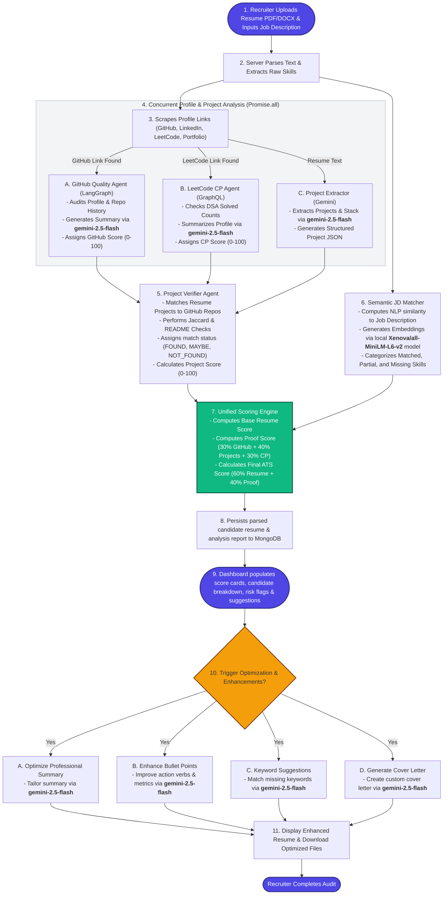

# ATSMaster: AI-Powered Recruitment Intelligence Platform

[](https://opensource.org/licenses/MIT)
[](http://makeapullrequest.com)

> **Resume AI + Verification Agents**: A complete recruitment intelligence platform that analyzes resumes, scores compatibility, and autonomously verifies candidate credentials using AI agents.

---

## 📹 [View Demo](https://drive.google.com/file/d/1uHXCcIivdMlcJG-iVCFQRe5uftH68cST/view)

Watch a live demonstration of ATSMaster in action!

---

## 🎯 What is ATSMaster?

ATSMaster is a cutting-edge full-stack application that revolutionizes the recruitment process by combining:

1. **Resume Analysis Engine** - Intelligent scoring and optimization using NLP
2. **Recruiter Intelligence Tools** - Bulk screening, analytics, and insights
3. **Autonomous Verification Agents** - AI agents that verify candidate credentials automatically

**The Problem:** Recruiters waste hours manually checking resumes and verifying candidate claims across GitHub, LinkedIn, and portfolios.

**The Solution:** ATSMaster automates the entire process with intelligent agents that work 24/7 to verify credentials, detect resume fraud, and provide credibility scores.

---

## ✨ Key Features

### Phase 1: Resume Analysis & Optimization
- 📄 **Resume Upload & Parsing** - PDF/DOCX support with intelligent data extraction
- 🎯 **ATS Score Calculation** - Semantic similarity + keyword matching (0-100 scale)
- 💡 **Smart Suggestions** - AI-powered recommendations for resume optimization
- 🔍 **Detailed Analysis** - Matched, partially matched, and missing skills breakdown
- 📊 **Side-by-Side Comparison** - Original vs. optimized resume preview

### Phase 2: Recruiter Dashboard
- 📋 **Multi-Resume Analysis** - Bulk upload and comparative ranking
- 🎨 **Recruiter Dashboard** - Advanced filtering, sorting, and candidate management
- 📈 **Analytics & Insights** - Trending skills, market demand, performance metrics
- 🎨 **Resume Templates** - ATS-friendly templates with drag-and-drop builder
- 🔗 **Job Database Integration** - LinkedIn, Indeed, Glassdoor API integration

### Phase 3: AI Verification Agents ⭐
- 🤖 **GitHub Verifier** - Validates repositories, commits, and project claims
- 💼 **LinkedIn Verifier** - Confirms employment history, endorsements, and connections
- 🌐 **Portfolio Verifier** - Checks live projects, accessibility, and responsiveness
- 🌟 **OpenSource Verifier** - Validates contributions to major open-source projects
- 🧠 **Supervisor Agent** - Orchestrates all agents using LangGraph ReAct pattern
- 📊 **Credibility Scoring** - Composite scores with detailed evidence reports

---

## 🔄 Architecture



---

## 🚀 Getting Started

### Prerequisites

- **Node.js** (v16 or higher)
- **Python** (v3.8 or higher)
- **MongoDB** (v5.0 or higher)
- **npm** or **yarn**

### Installation

1. **Clone the repository**
   ```bash
   git clone https://github.com/shivraj2805/atsmaster.git
   cd atsmaster
   ```

2. **Install dependencies**

   **Backend:**
   ```bash
   cd server
   npm install
   ```

   **Frontend:**
   ```bash
   cd client
   npm install
   ```

   **Agents:**
   ```bash
   cd agents
   pip install -r requirements.txt
   ```

3. **Set up environment variables**

   Create `.env` files in `server/`, `client/`, and `agents/` directories:

   **server/.env:**
   ```env
   PORT=5000
   MONGODB_URI=mongodb://localhost:27017/atsmaster
   JWT_SECRET=your_jwt_secret
   NODE_ENV=development
   ```

   **agents/.env:**
   ```env
   OPENAI_API_KEY=your_openai_api_key
   LANGCHAIN_API_KEY=your_langchain_api_key
   GITHUB_TOKEN=your_github_token
   LINKEDIN_API_KEY=your_linkedin_api_key
   ```

4. **Start the development servers**

   **Backend:**
   ```bash
   cd server
   npm run dev
   ```

   **Frontend:**
   ```bash
   cd client
   npm start
   ```

   **Agents:**
   ```bash
   cd agents
   python main.py
   ```

5. **Access the application**
   - Frontend: http://localhost:3000
   - Backend API: http://localhost:5000
   - Agent API: http://localhost:8000

---

## 📖 Documentation

Comprehensive documentation is available in the `docs/` directory:

### Getting Started
- [📍 Start Here](docs/ATS-Start-Here.md) - Quick start guide and project overview
- [📋 Complete Plan](docs/ATS-Master-Complete-Plan.md) - 16-week implementation roadmap

### Architecture & Code
- [🏗️ Agent Architecture](docs/ATS-Agent-Architecture-Diagram.md) - Detailed agent system design
- [💻 Code Patterns](docs/ATS-Agent-Code-Patterns.md) - Implementation patterns and examples
- [📊 Agent Pipeline](docs/ATS-Agent-Pipeline.md) - Agent workflow and data flow

### Deployment & Costs 💰
- [💰 Project Costing](docs/PROJECT-COSTING.md) - Complete cost breakdown in INR (AI APIs, AWS, GitHub)

### Resources
- [📚 Resource Index](docs/ATS-Resource-Index.md) - Complete documentation index
- [🎉 Delivery Summary](docs/ATS-DELIVERY-SUMMARY.md) - Project deliverables and milestones

---

## 💰 Deployment Costs (All in INR)

**Complete cost breakdown available!** Here's what you need to know:

```
AWS Deployment:
MVP (< 100 users):              ₹2,211/month
Small Production (100-1K):      ₹10,823/month
Medium Production (1K-5K):      ₹22,908/month
Large Production (5K-20K):      ₹51,211/month

AI API Costs (Gemini - Recommended):
Cost per resume:                ₹0.053
100 users (1,000 analyses):     ₹53/month
1,000 users (10,000 analyses):  ₹531/month
10,000 users (100K analyses):   ₹5,312/month

GitHub Agent: FREE (5,000 requests/hour)
```

**Key Points:**
- ✅ Gemini is 2× cheaper than OpenAI (₹0.053 vs ₹0.106 per resume)
- ✅ GitHub API is completely FREE with authenticated token
- ✅ AWS deployment scales efficiently from ₹2K to ₹2L/month
- ✅ Can start with just ₹2,158/month for MVP
- ✅ Potential 50-70% savings with optimization strategies

📖 **Full details:** See [PROJECT-COSTING.md](docs/PROJECT-COSTING.md) for comprehensive breakdown including bulk upload scenarios and recruiter platform costing.

---

## 🛠️ Tech Stack

### Frontend
- **React** - UI framework
- **Redux Toolkit** - State management
- **Material-UI** - Component library
- **Recharts** - Data visualization
- **Axios** - HTTP client

### Backend
- **Node.js** - Runtime environment
- **Express.js** - Web framework
- **MongoDB** - Database
- **Mongoose** - ODM
- **JWT** - Authentication

### AI & Agents
- **Python** - Agent runtime
- **LangGraph** - Agent orchestration
- **LangChain** - LLM framework
- **OpenAI GPT-4** - Language model
- **spaCy** - NLP processing
- **BeautifulSoup** - Web scraping

---

## 🎓 Learning Outcomes

By building ATSMaster, you'll master:

### Frontend Development
- React hooks and state management
- Real-time dashboards and data visualization
- Form validation and file handling
- Responsive design patterns

### Backend Development
- RESTful API design
- Authentication and authorization
- File upload and processing
- Database modeling and optimization

### AI & Machine Learning
- Natural Language Processing (NLP)
- Semantic similarity and embeddings
- LangGraph agent orchestration
- ReAct pattern implementation

### DevOps
- Docker containerization
- CI/CD pipelines
- Cloud deployment (AWS/GCP)
- Monitoring and logging

---

## 📊 Project Timeline

| Phase | Duration | Features |
|-------|----------|----------|
| **Phase 1: Foundation** | Weeks 1-6 | Resume analysis, ATS scoring, optimization suggestions |
| **Phase 2: Scale** | Weeks 7-12 | Multi-resume analysis, recruiter dashboard, analytics |
| **Phase 3: Agents** | Weeks 13-16 | AI verification agents, credibility scoring, reports |

**Total Duration:** 16 weeks (130-150 hours)

---

## 🤝 Contributing

Contributions are welcome! Please follow these steps:

1. Fork the repository
2. Create a feature branch (`git checkout -b feature/AmazingFeature`)
3. Commit your changes (`git commit -m 'Add some AmazingFeature'`)
4. Push to the branch (`git push origin feature/AmazingFeature`)
5. Open a Pull Request

Please read [CONTRIBUTING.md](CONTRIBUTING.md) for details on our code of conduct and development process.

---

## 🐛 Bug Reports & Feature Requests

Found a bug or have a feature request? Please open an issue on GitHub with:
- Clear description of the problem/feature
- Steps to reproduce (for bugs)
- Expected vs. actual behavior
- Screenshots (if applicable)

---

## 📝 License

This project is licensed under the MIT License - see the [LICENSE](LICENSE) file for details.

---

## 🌟 Acknowledgments

- **LangChain** for the agent framework
- **OpenAI** for GPT-4 API
- **MongoDB** for database support
- **React** community for awesome components

---

## 📧 Contact

**Project Maintainer:** Shivraj Darekar

- Email: shivdarekar2806@gmail.com
- LinkedIn: [Shivraj Darekar](https://linkedin.com/in/shivrajdarekar)
- GitHub: [@shivraj2805](https://github.com/shivraj2805)

---

## 🚀 Roadmap

- [x] Phase 1: Resume Analysis Engine
- [x] Phase 2: Recruiter Dashboard
- [x] Phase 3: AI Verification Agents
- [ ] Phase 4: Mobile App (iOS/Android)
- [ ] Phase 5: Chrome Extension
- [ ] Phase 6: Integration with major ATS platforms (Workday, Greenhouse, etc.)
- [ ] Phase 7: Real-time video interview analysis
- [ ] Phase 8: Candidate skill gap assessment and training recommendations

---

<p align="center">Made with ❤️ by Shivraj Darekar</p>
<p align="center">⭐ Star this repo if you find it helpful!</p>
