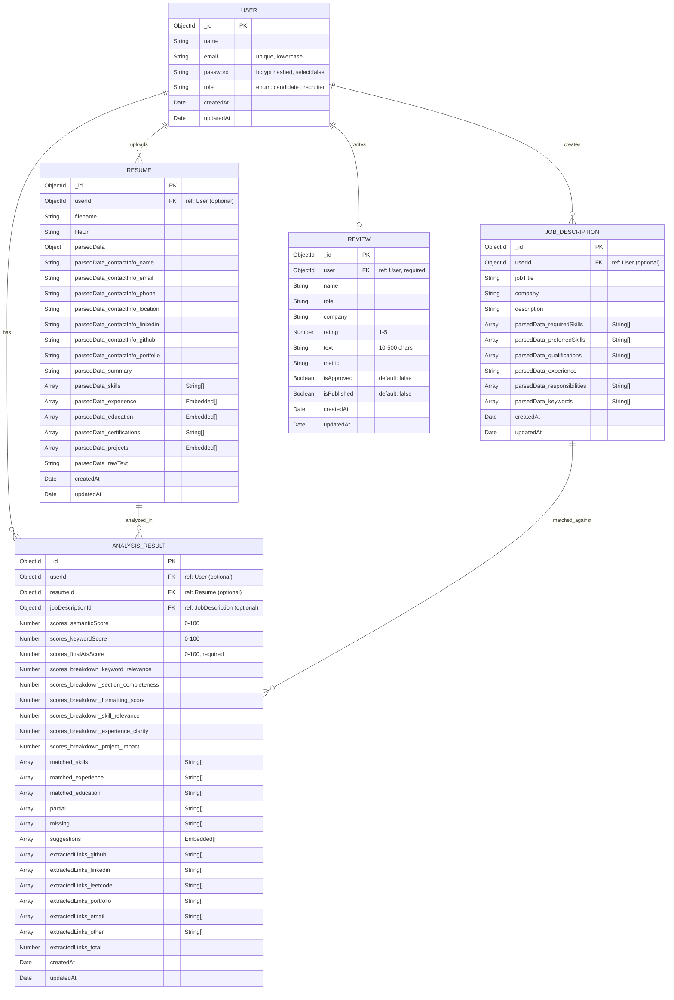

# ATS Master — Entity Relationship Diagram

> **Database:** MongoDB (NoSQL / Document Store via Mongoose ODM)  
> **Notation:** Each collection is represented as an entity. Relationships are expressed via `ObjectId` references (similar to foreign keys in SQL).

---

## 1. ER Diagram (Mermaid)



---

## 2. Collection Details

### 2.1 `users` Collection

Stores registered accounts. Supports two roles: `candidate` and `recruiter`.

| Field | Type | Constraints | Notes |
|---|---|---|---|
| `_id` | ObjectId | PK | Auto-generated by MongoDB |
| `name` | String | required, trim | Display name |
| `email` | String | required, unique, lowercase | Used for login |
| `password` | String | required, min 6 chars | bcrypt hashed; `select: false` |
| `role` | String | enum: `candidate`/`recruiter` | Default: `candidate` |
| `createdAt` | Date | auto | Mongoose timestamps |
| `updatedAt` | Date | auto | Mongoose timestamps |

**Indexes:** Default `_id`, unique `email`

---

### 2.2 `resumes` Collection

Stores uploaded resume metadata and AI-parsed structured content.

| Field | Type | Notes |
|---|---|---|
| `_id` | ObjectId | PK |
| `userId` | ObjectId → `users` | Optional (allows anonymous uploads) |
| `filename` | String | Original uploaded filename |
| `fileUrl` | String | Path/URL to stored file |
| `parsedData.contactInfo` | Embedded Object | name, email, phone, location, linkedin, github, portfolio |
| `parsedData.summary` | String | Professional summary text |
| `parsedData.skills` | String[] | Flat list of extracted skills |
| `parsedData.experience` | Array of Objects | `{company, position, duration, description, bullets[]}` |
| `parsedData.education` | Array of Objects | `{institution, degree, field, year, gpa}` |
| `parsedData.certifications` | String[] | Certificate names |
| `parsedData.projects` | Array of Objects | `{name, description, technologies[], links[]}` |
| `parsedData.rawText` | String | Full extracted text from PDF/DOCX |
| `createdAt` / `updatedAt` | Date | Mongoose timestamps |

**Indexes:** `{ userId: 1, createdAt: -1 }` — for efficient user history queries

---

### 2.3 `jobdescriptions` Collection

Stores job descriptions with AI-parsed keyword data used for resume matching.

| Field | Type | Notes |
|---|---|---|
| `_id` | ObjectId | PK |
| `userId` | ObjectId → `users` | Optional (allows anonymous JDs) |
| `jobTitle` | String | required, trim |
| `company` | String | Optional company name |
| `description` | String | Full JD text (required) |
| `parsedData.requiredSkills` | String[] | Hard required skills extracted by AI |
| `parsedData.preferredSkills` | String[] | Nice-to-have skills |
| `parsedData.qualifications` | String[] | Degree / certification requirements |
| `parsedData.experience` | String | Experience level requirement |
| `parsedData.responsibilities` | String[] | Key job responsibilities |
| `parsedData.keywords` | String[] | ATS keywords identified in JD |
| `createdAt` / `updatedAt` | Date | Mongoose timestamps |

**Indexes:** `{ userId: 1, createdAt: -1 }`

---

### 2.4 `analysisresults` Collection

The central scoring document linking a resume to a job description with detailed ATS analysis.

| Field | Type | Notes |
|---|---|---|
| `_id` | ObjectId | PK |
| `userId` | ObjectId → `users` | Optional |
| `resumeId` | ObjectId → `resumes` | Optional |
| `jobDescriptionId` | ObjectId → `jobdescriptions` | Optional |
| `scores.semanticScore` | Number (0–100) | Cosine similarity score |
| `scores.keywordScore` | Number (0–100) | TF-IDF keyword match score |
| `scores.finalAtsScore` | Number (0–100) | **Composite ATS score** (required) |
| `scores.breakdown.keyword_relevance` | Number | Sub-score component |
| `scores.breakdown.section_completeness` | Number | Sub-score component |
| `scores.breakdown.formatting_score` | Number | Sub-score component |
| `scores.breakdown.skill_relevance` | Number | Sub-score component |
| `scores.breakdown.experience_clarity` | Number | Sub-score component |
| `scores.breakdown.project_impact` | Number | Sub-score component |
| `matched.skills` | String[] | Skills present in both resume & JD |
| `matched.experience` | String[] | Matched experience keywords |
| `matched.education` | String[] | Matched education requirements |
| `partial` | String[] | Partially matched keywords |
| `missing` | String[] | Skills/keywords missing from resume |
| `suggestions` | Array of Objects | `{category, suggestion, priority}` |
| `extractedLinks.github` | String[] | GitHub URLs from PDF |
| `extractedLinks.linkedin` | String[] | LinkedIn URLs |
| `extractedLinks.leetcode` | String[] | LeetCode profile URLs |
| `extractedLinks.portfolio` | String[] | Portfolio / personal site URLs |
| `extractedLinks.email` | String[] | Email addresses |
| `extractedLinks.other` | String[] | Other extracted links |
| `extractedLinks.total` | Number | Total count of extracted links |
| `createdAt` / `updatedAt` | Date | Mongoose timestamps |

**Indexes:**
- `{ userId: 1, createdAt: -1 }` — user history
- `{ resumeId: 1 }` — resume lookup
- `{ 'scores.finalAtsScore': -1 }` — leaderboard / sorting

**Suggestions sub-document:**

| Field | Values |
|---|---|
| `category` | `keyword` / `formatting` / `experience` / `skills` / `education` / `summary` / `general` |
| `priority` | `high` / `medium` / `low` |

---

### 2.5 `reviews` Collection

Stores user-submitted testimonials/reviews for the platform.

| Field | Type | Notes |
|---|---|---|
| `_id` | ObjectId | PK |
| `user` | ObjectId → `users` | **required** |
| `name` | String | required |
| `role` | String | Reviewer's job title (required) |
| `company` | String | Optional company name |
| `rating` | Number (1–5) | required |
| `text` | String | 10–500 chars (required) |
| `metric` | String | Optional key metric (e.g. "Score improved 40%") |
| `isApproved` | Boolean | Admin approval flag (default: false) |
| `isPublished` | Boolean | Visibility flag (default: false) |
| `createdAt` / `updatedAt` | Date | Mongoose timestamps |

**Indexes:**
- `{ isPublished: 1, rating: -1 }` — published reviews sorted by rating
- `{ user: 1 }` — user's own review lookup

---

## 3. Relationship Summary

```
USER ──────────── RESUME
  │  1 user can have many resumes (0..*)
  │
USER ──────────── JOB_DESCRIPTION
  │  1 user can save many job descriptions (0..*)
  │
USER ──────────── ANALYSIS_RESULT
  │  1 user can have many analysis results (0..*)
  │
USER ──────────── REVIEW
  │  1 user can submit at most 1 review (0..1)
  │
RESUME ────────── ANALYSIS_RESULT
  │  1 resume can be analyzed multiple times (0..*)
  │
JOB_DESCRIPTION ─ ANALYSIS_RESULT
     1 JD can be matched against multiple resumes (0..*)
```

> **Note:** All foreign key references are **optional** in the schema to support anonymous (unauthenticated) usage — users can analyze resumes without creating an account. When authenticated, all documents are linked to the user's `_id` for history tracking.

---

## 4. Index Strategy

| Collection | Index | Purpose |
|---|---|---|
| `users` | `{ email: 1 }` unique | Fast login lookup |
| `resumes` | `{ userId: 1, createdAt: -1 }` | User history (latest first) |
| `jobdescriptions` | `{ userId: 1, createdAt: -1 }` | User's saved JDs |
| `analysisresults` | `{ userId: 1, createdAt: -1 }` | User's analysis history |
| `analysisresults` | `{ resumeId: 1 }` | Fetch analyses for a resume |
| `analysisresults` | `{ 'scores.finalAtsScore': -1 }` | Score sorting / leaderboard |
| `reviews` | `{ isPublished: 1, rating: -1 }` | Public review feed |
| `reviews` | `{ user: 1 }` | User's own review lookup |
