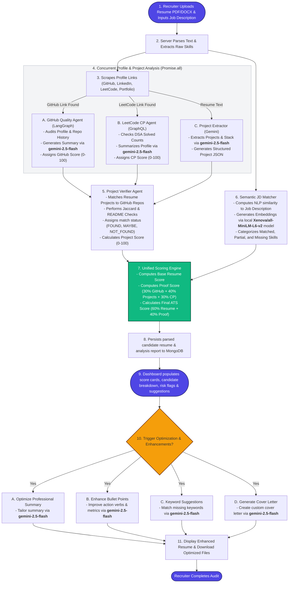

# End-to-End User Workflow & Data Flow

This document details the chronological workflow of **ATSMaster**—from the moment a recruiter uploads a candidate's resume to the generation of the final dashboard metrics, including the follow-up resume optimization & enhancement features.

---

## 🔄 End-to-End Workflow Diagram

---

## 🏃‍♂️ Chronological Processing Steps

### 1. Upload & Intake
* The recruiter uploads the candidate's resume (PDF or DOCX) and pastes the target job description (JD) on the ATSMaster interface.

### 2. Parse & Structural Extraction
* The Express server parses the uploaded file to extract raw text.
* Identifies contact info, experience blocks, and extracts a preliminary set of skills (languages, frameworks, tools) using a local dictionary rules engine.

### 3. Hyperlink Scraper
* Scrapes the resume PDF for hyperlinks (both visible URLs and anchor text link annotations).
* Groups profiles into logical buckets: GitHub, LeetCode, LinkedIn, Portfolios, and Emails.

### 4. Concurrent Profile Audits & Project Extraction
To save latency, three operations launch in parallel:
* **GitHub Profile Analysis**: The LangGraph agent runs a quality check on the candidate's top repositories (verifying tests, CI pipelines, README depth, and activity). Generates recruiter summaries using the **gemini-2.5-flash** model.
* **LeetCode Profile Analysis**: Queries LeetCode's GraphQL API for solved stats (categorized by Easy/Medium/Hard) and enriches it using the **gemini-2.5-flash** model to summarize competency.
* **Project Extractor**: Instructs the **gemini-2.5-flash** model to extract a list of projects claimed on the resume.

### 5. Project Verification
* Compares the projects extracted from the resume against the candidate's actual repositories.
* Performs token Jaccard similarity searches, queries the GitHub API for project README files to verify project details, and computes a quality score for each matching repository.
* Applies a penalty multiplier if projects claimed on the resume cannot be verified.

### 6. Semantic Alignment Matcher
* Compares the parsed resume text against the job description using semantic NLP engines.
* Uses the **Xenova/all-MiniLM-L6-v2** local sentence-transformer model (via `@xenova/transformers`) to generate sentence embeddings and evaluate skill gaps using cosine similarity matching.
* Categorizes skills into matched, partially matched, and missing categories.

### 7. Unified Scoring Engine
* Calculates a baseline score for the resume text matching.
* Aggregates the verified credentials into a **Proof Score**:
  $$\text{ProofScore} = 0.30 \times \text{GitHub} + 0.40 \times \text{VerifiedProjects} + 0.30 \times \text{LeetCode}$$
* Formulates the final weighted credibility rating:
  $$\text{Final ATS Score} = 0.60 \times \text{ResumeScore} + 0.40 \times \text{ProofScore}$$

### 8. Storage
* Stores the parsed resume structure and the detailed analysis results in the MongoDB database.

### 9. Dashboard Render
* Displays the candidate's credibility rating, component breakdown (Resume match vs. verified profile proof), missing skills list, and risk flags to the recruiter.

### 10. Optimization & Enhancements Flow
Recruiters and candidates can trigger automated resume enhancement features on-demand:
* **Professional Summary Optimization**: Uses **gemini-2.5-flash** to rewrite the candidate's summary to align with the job description.
* **Bullet Point Enhancement**: Uses **gemini-2.5-flash** to rewrite experience bullet points, incorporating strong action verbs and metrics.
* **Keyword Suggestions**: Uses **gemini-2.5-flash** to identify missing target keywords and suggest optimal placements.
* **Cover Letter Generation**: Uses **gemini-2.5-flash** to write a customized, job-aligned cover letter based on the candidate's parsed credentials.

---

## 🤖 AI Models & Embeddings Registry

| Feature Area | Model Name | Technology Type | Purpose |
| :--- | :--- | :--- | :--- |
| **Semantic Matching** | `Xenova/all-MiniLM-L6-v2` | Sentence Transformer (Local) | Generates text embeddings; evaluates cosine similarity for skill match level audits. |
| **Profile Summaries** | `gemini-2.5-flash` | Generative LLM (API) | Condenses GitHub agent reports and LeetCode stats into concise recruiter readouts. |
| **Project Extraction** | `gemini-2.5-flash` | Generative LLM (API) | Parses raw resume text into structured JSON project formats. |
| **Summary Optimization** | `gemini-2.5-flash` | Generative LLM (API) | Aligns the candidate summary with target role requirements. |
| **Bullet Point Enhancer** | `gemini-2.5-flash` | Generative LLM (API) | Re-drafts bullet points using strong action verbs and quantitative metrics. |
| **Keyword Placements** | `gemini-2.5-flash` | Generative LLM (API) | Suggests missing key terminology. |
| **Cover Letter Generator** | `gemini-2.5-flash` | Generative LLM (API) | Creates job-aligned cover letters on-demand. |

