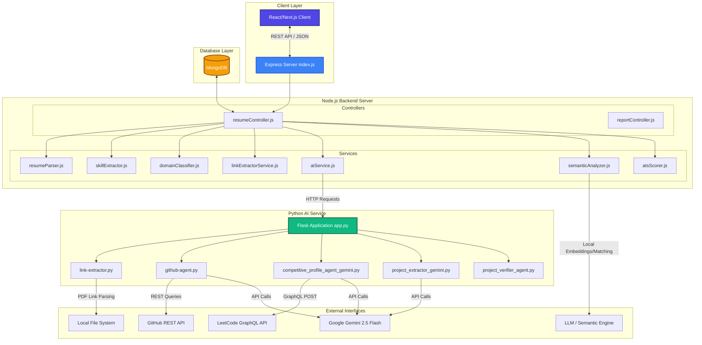
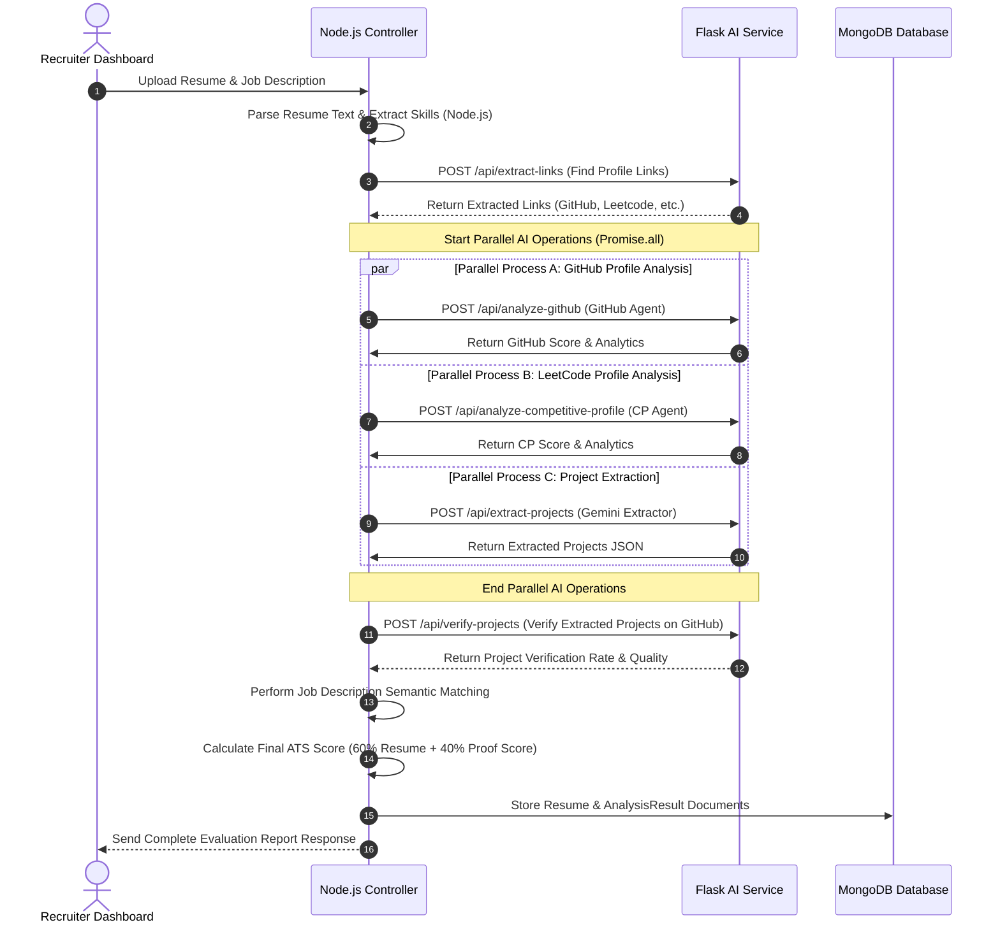

# ATS Master Full Architecture & Data Flow

This document details the complete end-to-end architecture and system interactions of the **ATS Master** application.

---

## 🏗️ System Architecture & Data Flow (Mermaid Diagram)

---

## ⚡ Parallel Execution Optimization Model

To optimize response times, the Node.js backend implements a parallel promise execution pattern (`Promise.all`) during resume processing. Instead of executing steps sequentially, independent tasks run concurrently:

---

## 📐 Scoring Formula Breakdowns

The application uses a hybrid evaluation system combining written resumes with live proof of expertise:

### 1. Proof Score
The proof score validates claims by looking at public profiles:
$$\text{ProofScore} = 0.30 \times \text{GitHubScore} + 0.40 \times \text{ProjectScore} + 0.30 \times \text{CPScore}$$
*   **GitHubScore**: Evaluated by the GitHub Quality Agent (0-100).
*   **CPScore**: Evaluated by the Competitive Profile Agent (0-100).
*   **ProjectScore**: Project Verification Rate (0-100) adjusted by average verified project quality and penalized for unverified projects:
    $$\text{ProjectScore} = \left( 0.70 \times \text{VerificationScore} + 0.30 \times \text{AvgProjectQuality} \right) \times e^{-1.2 \times \frac{N}{T}}$$

### 2. Final ATS Score
The final score balances written content matching with live developer portfolio verifications:
$$\text{Final ATS Score} = 0.60 \times \text{ResumeScore} + 0.40 \times \text{ProofScore}$$
*   **ResumeScore**: Initial keyword, skill coverages, semantic similarity matching score (0-100).
*   If profile URLs are not present (e.g., missing GitHub or Leetcode links), their values default to 0 in the calculation.

---

## 🗄️ Database Schema Structures

### `Resumes` Collection
Stores the parsed candidate profile data:
*   `userId`: Reference to the recruiter/user.
*   `filename`: Original uploaded filename.
*   `parsedData`: Structured fields containing contact info, professional summary, skills lists, experience bullets, education, and project lists.

### `JobDescriptions` Collection
Stores details of the target job requirement:
*   `userId`: Reference to the recruiter/user.
*   `jobTitle` / `company`: Metadata.
*   `description`: Raw text of the requirements.
*   `parsedData`: Extracted required skills and domain classification.

### `AnalysisResults` Collection
Maps the resume to the job description and aggregates scoring metadata:
*   `resumeId` / `jobDescriptionId`: Relationship references.
*   `scores`: Combines semantic scores, keyword matching scores, overall final ATS score, and the complete scoring formula breakdown (weights, raw profile scores).
*   `matched` / `partial` / `missing`: Lists of candidate skills matching target roles.
*   `suggestions`: Detailed lists of improvement tasks.
*   `extractedLinks`: List of all hyperlinks found in the resume.
