# GitHub Quality Agent Flow

This document details the architecture and execution flow of the **GitHub Quality Agent**, which evaluates the engineering maturity, activity, and alignment of a candidate's GitHub profile.

---

## 🔄 Agent Execution Flow (Mermaid Diagram)

```mermaid
graph TD
    StartNode(["Start Analysis"]) --> ParseInput["1. parse_input"]
    
    subgraph InputProcessing ["Input Processing"]
        ParseInput --> |Clean Keywords & Initialize State| FetchProfile["2. fetch_profile"]
    end

    subgraph DataExtraction ["Data Extraction (GitHub API)"]
        FetchProfile --> |GET /users/username| FetchRepos["3. fetch_repos"]
        FetchRepos --> |GET /users/username/repos| ScoreRepos["4. score_all_repos"]
    end

    subgraph RepoEvaluation ["Repo Evaluation & Scoring"]
        ScoreRepos --> SortRepos[Sort repos by pushed_at]
        SortRepos --> DeepFilter{"Is in Top 35 Repos?"}
        
        DeepFilter -->|Yes: Run Deep Check| FetchFull["GET /repos/owner/repo for topics"]
        FetchFull --> FetchComm["GET .../community/profile"]
        FetchComm --> CheckCI["Check CI Workflows & Tests"]
        CheckCI --> FetchReadme["GET .../readme"]
        FetchReadme --> DetectFiles["Detect Dockerfile / package.json"]
        
        DeepFilter -->|No| UseDefaults[Use Default Baseline Stats]
        
        DetectFiles --> CalcRepoScore[Calculate Individual Repo Scores]
        UseDefaults --> CalcRepoScore
    end

    subgraph AggregateScoring ["Aggregate Scoring"]
        CalcRepoScore --> ProfileScoring["5. overall_scoring"]
        ProfileScoring --> CalcProfile["Calculate Profile Score 25%"]
        CalcRepoAvg["Calculate Repo Average Score 55% from Top 40% Repos"]
        CalcProfile --> CalcRepoAvg
        AddBonuses["Add Star & Strong Repo Bonuses"]
        CalcRepoAvg --> AddBonuses
        AddBonuses --> ClampScore[Clamp Score to 0-100]
    end

    subgraph SummarizationFinalization ["Summarization & Finalization"]
        ClampScore --> LLMSummary["6. llm_summary"]
        LLMSummary --> |Gemini 2.5 Flash API| Finalize["7. finalize"]
        Finalize --> BuildFinal["8. build_final_output"]
        BuildFinal --> EndNode(["Return Recruiter JSON"])
    end

    style StartNode fill:#4F46E5,stroke:#312E81,stroke-width:2px,color:#fff
    style EndNode fill:#4F46E5,stroke:#312E81,stroke-width:2px,color:#fff
    style DeepFilter fill:#F59E0B,stroke:#78350F,stroke-width:2px
    style LLMSummary fill:#10B981,stroke:#064E3B,stroke-width:2px,color:#fff
```

---

## 🛠️ Step-by-Step Execution Walkthrough

### 1. `parse_input`
* Cleans the keywords provided in the job description (converts to lowercase, trims whitespace, removes duplicates).
* Initializes the state dictionary containing repo lists, scores, errors, and parameters.

### 2. `fetch_profile`
* Queries the GitHub API: `GET https://api.github.com/users/{username}`
* Retrieves candidate bio, followers count, blog/website link, location, company, email, and public repository counts.

### 3. `fetch_repos`
* Queries: `GET https://api.github.com/users/{username}/repos`
* Iterates through paginated results (up to 100 repositories per page) to retrieve all public repositories.

### 4. `score_all_repos`
* Sorts repositories by `pushed_at` / `updated_at` (recency) to focus analytical effort.
* Applies a **Deep Check** to the top 35 repositories:
  * **Topics**: Queries `/repos/{owner}/{name}` to fetch topic tags.
  * **Community Health**: Queries `/repos/{owner}/{name}/community/profile` (baseline is 60%).
  * **CI Check**: Verifies if GitHub Actions workflows exist.
  * **Tests Check**: Scans for files/directories containing `test`, `tests`, `__tests__`, `pytest.ini`, `jest.config.js`, etc.
  * **Tech Signatures**: Detects if `Dockerfile` or `package.json` are present.
  * **README**: Fetches and evaluates README content length and quality.
* Repositories outside the top 35 use default fallback metrics to conserve rate limits.
* Calculates individual repository scores from **35 to 100** using a weighted metric.

### 5. `overall_scoring`
Combines the profile parameters and individual repository metrics into a single deterministic score:
* **Profile Score (25%)**: Evaluates bio length (+20), blog existence (+15), location/company/email presence (+5 each), followers (log-scaled, +25 max), and public repository count (+25 max).
* **Repository Average (55%)**: Takes the average score of the **Top 40%** repositories (ignoring low-scoring, inactive, or placeholder repos to prevent penalizing strong profiles).
* **Star Portfolio Bonus**: Adds a log-scaled bonus of up to **+20 points** based on total stargazers.
* **Strong Repo Bonus**: Adds **+2.5 points** per repository with a score of 80 or higher (up to **+10 points** max).
* Clamps the final score between **0 and 100**.

### 6. `llm_summary`
* Sends the top 5 projects, weak projects, overall score, and target keywords to **Gemini 2.5 Flash**.
* Generates a concise, structured 3-line assessment outlining:
  * **Strengths**
  * **Gaps**
  * **Action Plan**

### 7. `finalize` & `build_final_output`
* Synthesizes all gathered metrics into a recruiter-friendly JSON object detailing:
  * `overall_score` & `grade` (Elite, Excellent, Strong, Good, Average, Learning).
  * `github_strength`: profile score, repo score, activity level, engineering maturity (Elite, High, Medium, Low), and project hygiene.
  * `top_projects`: names, URLs, scores of the top 5 repos.
  * `ats_signals`: keyword alignment, open-source impact, and consistency.
  * `risks` & `recommendations`: actionable advice (e.g. "Add LICENSE", "Add clear repo topics").

---

## 📊 Repository Scoring Formula & Weight Distribution

The individual repository scoring algorithm divides a maximum base score of 100 as follows:

| Dimension | Weight | Metrics Evaluated |
| :--- | :---: | :--- |
| **Popularity** | 30% | Log-scaled calculation of stars and forks. |
| **Meta-Data Hygiene** | 25% | Presence of description (+40), topics (+35), and README length (+35). |
| **Activity/Recency** | 20% | Days since last push (decay formula: $100 \times e^{-\text{days}/600}$). |
| **Engineering Maturity** | 10% | Presence of CI (+20), tests (+15), Dockerfile (+10), package.json (+10). |
| **Keyword Alignment** | 10% | Ratio of job description keywords found in description and README. |
| **Community Health** | 5% | Health percentage score retrieved from GitHub Community Profile. |

*Note: In addition to the base weights, a Star Bonus (up to +12) is added. If the repository is a fork, the score is multiplied by $0.92$. If archived, it is multiplied by $0.95$. The score is clamped to a minimum of 35.*
